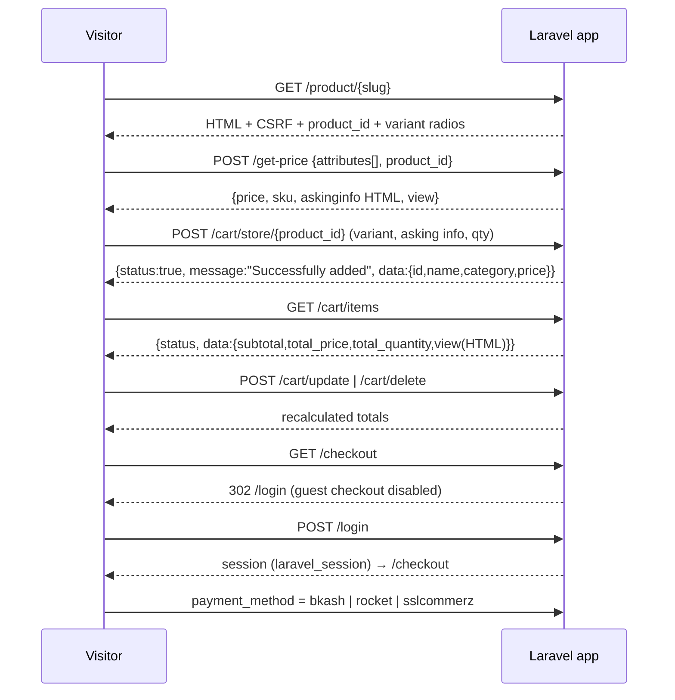
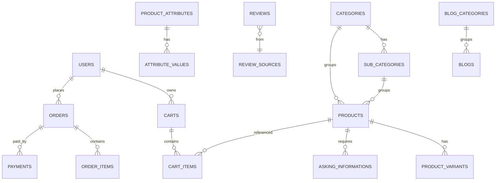

# Subscriptions BD — Full Website Reverse-Engineering Report

**Target:** https://subscriptionsbd.net (and alias domain `subscriptionsbd.com`)
**Recon date:** 23 October 2026 (Asia/Dhaka)
**Method:** black-box, unauthenticated crawl of the public site with a real Chromium browser (Playwright) to pass Cloudflare's managed challenge, plus static analysis of every downloaded HTML/JS/CSS asset.
**Status:** public pages fully mapped; checkout/payment UI is behind customer login and could not be captured (see §18 Limitations).

> Companion files, all produced by this engagement:
> - [`SUBSCRIPTIONSBD-PRODUCT-CATALOG.md`](SUBSCRIPTIONSBD-PRODUCT-CATALOG.md) — all 94 products, prices, stock, variants, credential fields.
> - [`SUBSCRIPTIONSBD-PAGES-AND-BLOGS.md`](SUBSCRIPTIONSBD-PAGES-AND-BLOGS.md) — every page captured and the 47-post blog archive.
> - `sbd-recon/` — raw evidence (167 saved pages, JS bundles, network captures, screenshots, JSON datasets, crawl scripts).

---

## 0. Executive summary

Subscriptions BD is a Bangladeshi **digital-subscription reseller** (ChatGPT, Canva, YouTube Premium, Microsoft 365, VPNs, antivirus keys, streaming accounts, etc.). It runs a **server-rendered Laravel + Blade + jQuery/Bootstrap** storefront behind **Cloudflare**, sells a catalog of **94 products in 8 categories**, takes payment with **bKash / Nagad / Rocket send-money + bKash Merchant Gateway + SSLCommerz card/MFS gateway**, and delivers credentials through the website dashboard/WhatsApp.

Ordering is a standard cart → login → checkout funnel. Checkout is **login-gated** (guests are redirected to `/login`), and account creation requires an **OTP verification** step that could not be completed during testing, so the checkout page itself was not reachable.

The most notable findings:

| Area | Finding |
|---|---|
| Stack | Laravel (PHP) + Blade, jQuery 3.7.1, Bootstrap 5.3.3, Swiper 11, SweetAlert2; Cloudflare CDN/WAF |
| Payments | bKash Merchant Gateway, SSLCommerz, manual bKash/Rocket "send money" forms; Stripe & PayPal appear only as partner logos (no SDK) |
| Auth | Laravel session auth + custom email/password controllers + custom OTP signup verification; **no social login**; password reset is broken (HTTP 500) |
| Mobile money | Marketing copy consistently: **bKash, Nagad, Rocket**; refund policy confirms bKash/Nagad/Rocket send-money, bKash Merchant Gateway and SSLCommerz |
| Risk | Checkout is gated; `/forgot-password` 500s; OTP resend fails; contact form endpoint is auth-gated; anti-devtools script; no HSTS/CSP/security headers on app responses |
| Scale | 94 products, 47 blog posts, 242 review cards, 106-entry instant-search index, 15,000+ claimed orders, "20,000 satisfied clients" |
| History | Re-platformed from WordPress/WooCommerce/Elementor (2024) to Laravel/Blade between Nov 2024 and Feb 2025 |

---

## 1. Business identity (as published on the site)

| Field | Value |
|---|---|
| Brand | Subscriptions BD / SubscriptionsBD |
| Domains | `subscriptionsbd.net`, `subscriptionsbd.com` (used interchangeably per Terms) |
| Launched | 2019 |
| Category | Digital products / OTT & SaaS subscriptions, license keys, gift cards |
| BD legal | Trade Licence No. **2201010800020367**, DBID No. **453105002** (Ministry of Commerce) |
| UK legal | Company Number **16441306** |
| BD address | 942/12/E, S Alam Jam Jam Tower, Laksam Road, Tomsombridge, Adarsha Sadar, Comilla-3500 |
| UK address | Flat 809, 71-75 Shelton Street, Covent Garden, London, WC2H 9JQ |
| Email | `info@subscriptionsbd.com` (mailbox on Titan Email — MX `mx1/mx2.titan.email`, SPF `include:spf.titan.email`, DMARC `p=none`) |
| WhatsApp | +880 1622 633671 (`wa.me/8801622633671`, "message only", no calls) |
| Socials | Facebook `web.subscriptionsbd`, Messenger, Instagram `subscriptionsbd`, LinkedIn `company/subscriptionsbd`, Trustpilot |
| Working hours | Header: 10:30 AM – 12:30 AM (BD time); product pages: 10:30 AM – 12:30 PM; Terms: 10:00 AM – 01:00 AM (inconsistent) |
| Claims | 20,000 satisfied clients · 1,500 custom payments · 6 team members · 8 years · 15,000+ orders · Trustpilot 4.8/5 (189 reviews) · 242 reviews widget |

**Resell/service partners (About page):** Microsoft, Adobe, IDM; contact via WhatsApp/Messenger/Instagram.
**Payment partners (About page):** SSLCommerz, bKash, Stripe, PayPal (logos only — no Stripe/PayPal SDK is loaded anywhere).

---

## 2. Technology stack

### 2.1 Server / platform

| Layer | Technology | Evidence |
|---|---|---|
| Backend framework | **Laravel (PHP)** | `laravel_session` + `XSRF-TOKEN` cookies, `_token` CSRF fields, `meta[name=csrf-token]`, Laravel route/JSON error shapes (`{"message":"The GET method is not supported for route token/resend. Supported methods: POST."}`), `Vary: X-Inertia` header; encrypted cookies with Laravel's `{iv,value,mac,tag}` payload |
| Rendering | **Blade server-side templates** | full HTML per request, no hydration payload; jQuery DOM scripting |
| Inertia | middleware present but unused publicly | `Vary: X-Inertia` on every response; `X-Inertia` request returns normal HTML |
| CDN / WAF | **Cloudflare** (managed challenge, HTTP/3, NEL, zstd) | `server: cloudflare`, `cf-ray`, `cf-mitigated: challenge`, `cf_clearance` |
| Origin | hidden behind Cloudflare | no `X-Powered-By`; `server-timing` shows `cfOrigin;dur` |
| Email | Titan Email SMTP | DNS MX/SPF; also a Microsoft 365 domain-verification TXT record (`MS=ms16036166`) |
| Public file layout | `/frontend/*` (theme), `/backend/*` (admin assets), `/uploads/*` (media) | asset URLs; `/backend/` returns 403 directory |

### 2.2 Front-end

| Library | Version / source | Used for |
|---|---|---|
| jQuery | **3.7.1** (self-hosted) | all DOM/AJAX |
| Bootstrap | **5.3.3** bundle (self-hosted) | modals, offcanvas, dropdowns, tooltips |
| Swiper | **11.1.14** (self-hosted) | hero slider, product carousels, reviews |
| AOS | self-hosted | scroll animations |
| counterUp + jQuery Waypoint | self-hosted | animated statistics |
| SweetAlert2 | `/backend/vendor/sweetalert2/` | toast alerts (`swalAlert()`) |
| ion.rangeSlider | jsDelivr `2.3.1` | shop price range |
| intl-tel-input | jsDelivr `25.2.0` (+ utils 17.0.19) | international phone input on signup |
| html2pdf.js | cdnjs `0.9.2` | invoice PDF download |
| Google Fonts | Urbanist + Hind Siliguri | typography |
| Custom theme | `style-two.css` / `style-two.js` ("style 2" redesign) | header, hero, rails, tabs, PDP sticky bar, drawers |
| Custom JS | `custom.js`, `_cart.js`, `_product_detail.js`, `_developer.js`, `_product_policy.js`, `_share-popup.js`, `message-btn.js`, `ion-range-slider.js` | storefront behaviour |
| Anti-devtools | `/protection.min.js` | right-click/copy/devtools blocking |

**No client-side payment SDK exists** — no `stripe.js`, `paypal` SDK, SSLCommerz JS, bKash script or Nagad script on any of the 167 captured pages. Payment is entirely server-side (form POST + hosted redirect/callback), or manual "send money + transaction ID" forms.

### 2.3 Platform history (Wayback Machine)

The storefront was **re-platformed** during 2024–2025:

| Snapshot | Platform | Evidence |
|---|---|---|
| 2024-08-03 and 2024-11-09 | **WordPress + WooCommerce + Elementor** | 700–990 `wp-content`/`elementor` references, 400–500 `woocommerce` references per page; `/?wc-ajax=get_refreshed_fragments`, `/author/mmshofiq/`, `/adobe-illustrator/` product URLs, Helpie FAQ plugin page |
| 2025-02-14 | **Laravel storefront** (current stack) | `/frontend/assets/...`, `meta[name=csrf-token]`, new theme |
| 2025-06 onward | Laravel + the "style-2" redesign | `/frontend/assets/js/_cart.js`, `/checkout` already 302 → `/login` |

This explains several leftovers on the current site: the `/backend/*` asset tree, `Vary: X-Inertia`, stale `/product-category/*` links, dead `/author/*`-era URLs and WooCommerce-style cart semantics. Archived HTML is kept in `sbd-recon/evidence/wayback/`.

### 2.4 Marketing / analytics

| Service | ID |
|---|---|
| Google Tag Manager | `GTM-MK5GL7FM` |
| Google Analytics 4 | `G-T5PRGYD3L0` |
| Meta (Facebook) Pixel | `363732688077111` (`fbevents.js`, `fbq('track','AddToCart', …)` in `_product_detail.js`) |
| Microsoft Clarity | `tmzg18wkz2` |
| Cloudflare Web Analytics | `static.cloudflareinsights.com/beacon.min.js` |

---

## 3. Site architecture

```
/                                Home (hero, trust badges, 55 product links, 8 rails, FAQs, reviews, blog teasers)
/shop                            Catalog  + /shop?category=… & sub_category_id=… & price-from/to & orderBy & per_page & page & q
/product/{slug}                  94 product detail pages (variants, asking-info, cart form, FAQs, related rail)
/cart/index                      Cart page (line items, qty, remove, totals)
/checkout                        GATED → /login
/login  /signup                  Customer auth (session + OTP verification)
/signup/token/verify             OTP entry screen
/forgot-password                 BROKEN (500)
/dashboard, /customer/orders     GATED customer account area
/review                          Reviews hub (All / Facebook Group / Trustpilot / Facebook Page)
/blogs  /blogs-details/{slug}    1 listing + 47 posts (author, date, share, sidebar)
/about                           Company, legal IDs, partners, addresses
/contact-us                      Contact form (AJAX, endpoint is auth-gated)
/privacy-policy /terms-condition /return-refund-policy   Bilingual (Bangla default + English)
/devtools-blocked.html           Replacement page served by protection.min.js
```

- Sitemap `sitemap.xml` lists **161 URLs**: 94 products, 47 blog posts, 12 shop category views, 8 static pages.
- Unknown URLs **redirect to the homepage (302)** instead of returning 404.
- The **instant search index** (`#sh-index` inline JSON) contains **106 entries** (8 categories, 93 products, 5 static pages) with name, URL, and price/type.
- `/product-category/*` links that still exist in product cards are **dead** (redirect home).
- `/admin`, `/manage`, `/backend/login`, `/administrator` all redirect to `/` — no public admin surface was found. `/backend/` itself is 403 (asset directory only).

Full page-by-page list: [`SUBSCRIPTIONSBD-PAGES-AND-BLOGS.md`](SUBSCRIPTIONSBD-PAGES-AND-BLOGS.md).

---

## 4. Page-by-page walkthrough

### 4.1 Global header + footer (every page)

Header (style-2 redesign):

1. **Offer ticker** — 4 rotating promo links (ChatGPT discount, YouTube Premium stock, ChatGPT restock, Gemini Pro), Swiper vertical autoplay.
2. **Logo** → `/`.
3. **Search** — `#sh-q` with live suggestions from `#sh-index`; `/` or `Ctrl/⌘+K` focuses it; ↑/↓ navigate results, Enter opens the highlighted product, plain Enter without a selection submits `GET /shop?q=…`.
4. **Sign In** → `/login`.
5. **Cart button** — shows `0` / `0.00 ৳`; opens the `#viewCart` offcanvas (Bootstrap) with line items, subtotal, "view Cart", "Checkout".
6. **"All Categories" popover** — 8 category links, hover on desktop, click/↑↓/Esc on mobile.
7. **Nav** — Shop, About Us, Reviews, Blogs, Contact Us.
8. **Copy-email button** — copies `info@subscriptionsbd.com` to clipboard.
9. **Mobile burger** → left drawer `#sh-drawer` with the same navigation.
10. Sticky-header state (`is-stuck`) after 8 px scroll; header height published as `--hdr-h`.

Footer: brand blurb, BD address, WhatsApp, email, recent posts (5), COCC Trade Licence + DBID, Facebook/LinkedIn/Instagram, Useful Links (Privacy Policy, Returns → `/return-refund-policy`, Terms & Conditions → `/terms-condition`, About Us, Contact Us, Latest Blogs), copyright note, "verified by" image.
Floating action button (`#fab`): "Watch video" modal (`#popupVideos`), WhatsApp, Messenger.

### 4.2 Home page

- Split hero: headline "You're in Biggest shop for Digital products in Bangladesh", Trustpilot "Excellent" badge, BID/govt-verified artwork, **3-slide hero carousel** (Secure payment, Govt registered, Digital products) with progress bars, prev/next, swipe, autoplay; links to product pages.
- Stats counters: 100% secure / 100+ products / 2019 since.
- Trust strip ("Govt Verified", "Authentic Product", 242 reviews, "Registered by the Govt of the People's Republic of Bangladesh", 4.8/5 Trustpilot, Kaspersky partner note).
- **Find by categories** — 8 tiles.
- Product rails: **Best Selling Products**, **New Uploads**, **Utilities**, **Streaming Collection**, **Google Products**, **All Microsoft Products**, **Edu-Tech Tools**, **Career Hacker Tools** — each a horizontal rail with prev/next and page counter; **55 unique product links**, out-of-stock badges.
- **FAQ accordion** — 8 questions (AI tools, Microsoft 365 for business, Google Drive upgrade, etc.).
- **Reviews rail** — 242 reviews across 4 source tabs (All / Facebook Group / Trustpilot / Facebook Page), rendered as 106 cards on the homepage (53 All + 30 Trustpilot + 23 Facebook Page; the Facebook Group tab is empty in the served HTML).
- **Blog teasers** — 8 links to latest posts.
- Closing trust section, footer.

### 4.3 Shop page (`/shop`)

- Breadcrumb + title.
- **Filters**: categories (8) and sub-categories (6: Adobe Products, Antiviurs [sic], Google Products, Microsoft Products, AI and Writing Tools, Autodesk Products).
- **Price range** double-handle slider, bounds 10–16,000 ৳; on finish it writes `price-from` / `price-to` into the URL and reloads.
- **Sort**: default, latest, price low→high, price high→low (`orderBy`, `sort_by`).
- **Show**: 9 / 24 / 36 per page.
- **Grid density**: 2 / 3 / 4 columns; persisted in `localStorage["shop-grid-layout"]`.
- **Mobile "Filter"** offcanvas.
- Product cards: image, name, price or price range, "OUT OF STOCK" badge, cart icon link.
- **Pagination** (`?page=`).
- Search results use the same page (`?q=`).

### 4.4 Product detail page (`/product/{slug}`)

Full anatomy (ChatGPT page used as reference):

| Block | Behaviour |
|---|---|
| Breadcrumb | Shop → Category → Product |
| Product image | single main image (no gallery) |
| Category chip | → `/shop?category=…` |
| Social proof | "N sold in last 24 hours", "N People Watching this product now!" |
| Title + price range | `h1#pd-t`, live price `#price` |
| Short description | rich HTML "Product Description" |
| Variant selector | radio "duration cards"; changing one fires **`POST /get-price`**, which returns updated price, SKU, variant extra details, asking-information HTML and can append a second attribute group |
| Asking information | dynamic inputs (`asking_information[Your ChatGPT Email]`, `[ChatGPT Password]` …) — the site asks buyers to hand over third-party account credentials for "personal upgrade" products (12 products → 21 fields) |
| Warning checkbox | `extra_warning_label` — "I agree with the terms and don't have urgency" |
| Quantity | numeric input with −/+ (max length 4, min 1) |
| **ADD TO CART** | AJAX `POST /cart/store/{product_id}` (form `#addToCartForm`), toast on success, opens cart offcanvas; fires Meta `AddToCart` pixel |
| **BUY NOW** | same AJAX, then redirect to `data-redirect-to` = `/checkout` |
| Policy dialogs | `<dialog id="dlg-terms">`, `<dialog id="dlg-refund">` with **বাংলা / English** toggle |
| Sticky buy bar | appears when the order box scrolls away (mobile); mirrors live price; `data-top` scrolls back to order box |
| Tabs | Description / Additional Information / FAQs with scroll-spy; FAQs come from JSON-LD `FAQPage` |
| Reviews rail | site-wide 242 reviews, 4 source tabs, prev/next + counter |
| Share | Facebook / Twitter / WhatsApp popup windows (`_share-popup.js`) |
| Related products | horizontal rail |
| Delivery box | "Estimated Delivery: Within 3 Office hours", office hours, "Credentials / Information / Instructions will be provided in website dashboard", WhatsApp support |
| "Guaranteed Safe Checkout" | static banner image with card/MFS logos |

### 4.5 Cart page (`/cart/index`)

- Table of line items (image, name, qty −/+, item total, Remove).
- Quantity change → `POST /cart/update` with `{cart_id, quantity, _token}` → JSON `{status, data:{item_price, subtotal, total_price, total_quantity}}`; DOM updates in place.
- Remove → `POST /cart/delete` with `{cart_id}` → removes row and recalculates totals.
- Totals card: Subtotal / Total; "Continue To Shopping"; **"PROCEED TO CHECKOUT"** → `/checkout` → **302 `/login`** for guests.
- Separate **offcanvas mini-cart** (`/cart/items`) used by the header and after add-to-cart.

### 4.6 Checkout (`/checkout`) — gated

- Unauthenticated request: **302 → `/login`**. Guest checkout is disabled.
- The checkout UI could not be captured (see §18). Static evidence from `custom.js` shows the payment-method selector:

```js
// frontend/assets/js/custom.js
$("input[name='payment_method']").on("change", togglePaymentMethods);

function togglePaymentMethods() {
    if ($("#bkashCheckbox").prop("checked")) {
        $("#bkashForm").slideDown();
        $("#rocketForm").slideUp();
    } else if ($("#rocketCheckbox").prop("checked")) {
        $("#rocketForm").slideDown();
        $("#bkashForm").slideUp();
    } else {
        $("#bkashForm, #rocketForm").slideUp();
    }
}
```

- So the checkout page contains at least **bKash** and **Rocket** manual-payment forms toggled by radio inputs, plus a third option that shows neither manual form — almost certainly the **SSLCommerz hosted gateway** redirect (public copy and refund policy reference "SSLCommerz Gateway" and "bKash Merchant Gateway"). Nagad is advertised throughout, most likely through SSLCommerz rather than a separate manual form.

### 4.7 Auth pages

**`/login`** — plain Blade form: Email, Password (with show/hide), "Remember me" checked by default, "Forgot password?", "Don't have an account? Sign up". POST `/login`. Custom error copy: *"The provided email do not match our records."* / *"The provided password does not match our records."*

**`/signup`** — Name, Email, WhatsApp number (intl-tel-input, country auto-detected via `ipinfo.io/json?token=feb49731857e47`, BD fallback), Password, Confirm Password. POST `/signup` → **302 `/signup/token/verify`** and an OTP screen (`user_id` hidden field, code input, resend link with cooldown). OTP errors are JSON with remaining attempts, e.g. `{"status":false,"message":"Verification code does not match. Please try again. (2 attempt(s) left)"}`. Resend is `POST /token/resend?event=user_signed_up`; during testing it always returned **422 `{"message":"Something went wrong!"}`**, and no verification email reached two disposable inboxes — so the OTP channel is probably WhatsApp/SMS, or outbound mail is failing.

**Broken auth scaffolding:** `/forgot-password` → 500 "You do not have permission to view this resource."; `/reset-password/{token}` → 500; `/reset-password` GET → 405 (POST route exists); `/register` → 500; `/password/email` → redirect home. Password recovery is effectively unavailable.

**Logout** is `POST /logout` (GET → 405).

---

## 5. Button / interaction matrix

Verified by driving a real browser; network calls recorded.

| Control | Where | Action | Endpoint / mechanism |
|---|---|---|---|
| Offer ticker | header | Rotates 4 promos | JS autoplay → product links |
| Search typing | header | Live suggestions (max 7) from 106-entry index | client-side `#sh-index` JSON; `Enter` → `/shop?q=` |
| `/` or `Ctrl/⌘+K` | global | Focus search | keydown handler (`style-two.js`) |
| "All Categories" | header | Opens category popover (8 links) | `data-pop="sh-catp"` |
| Copy email | header | Copies `info@subscriptionsbd.com` | `navigator.clipboard` + selection fallback |
| Cart button | header | Opens cart offcanvas | Bootstrap offcanvas `#viewCart` |
| Sign In | header | → `/login` | GET |
| Burger | mobile | Opens drawer | `#sh-drawer` + scrim |
| Hero nav bars / arrows / swipe | home | Change slide | custom slider in `style-two.js` |
| Category tile | home | → filtered shop | `GET /shop?category=…` |
| Rail prev/next | home/product | Scroll rails + update counter | `data-rail-prev/next`, `window.sbdRailSync` |
| Product card | home/shop | → product page | GET |
| Variant radio | product | Updates price/SKU, may append next group + asking fields | `POST /get-price` `{attributes[], product_id, _token}` |
| Quantity −/+ | product/cart | Clamp/update quantity | client-side for PDP; AJAX for cart |
| Add to cart | product/card | Adds item, toast, opens mini-cart, Meta pixel | `POST /cart/store/{id}` |
| Buy now | product | Add then redirect | `POST /cart/store/{id}` → `/checkout` |
| Cart +/− | cart page | Recalculate line/totals | `POST /cart/update` |
| Remove | cart page | Delete line | `POST /cart/delete` |
| Proceed to checkout | cart/offcanvas | → `/checkout` | 302 → `/login` when guest |
| Grid 2/3/4 | shop | Re-layout grid | `localStorage["shop-grid-layout"]` |
| Sort dropdown | shop | Reload sorted | `?orderBy=latest|price&sort_by=asc|desc` |
| Per-page 9/24/36 | shop | Reload page size | `?per_page=` |
| Price slider | shop | Rewrites URL then reloads | `?price-from=&price-to=` (ion.rangeSlider) |
| Mobile Filter | shop | Offcanvas filters | Bootstrap |
| Review tabs | home/product/review | Switch source panes, reset rails | `[data-sbd-tabs]` |
| Policy buttons | product | `<dialog>` terms/refund with BN/EN switch | `_product_policy.js` |
| Share icons | product/blog | Popup share window | `window.open` (`_share-popup.js`) |
| Print invoice | customer order (gated) | Generates PDF | `html2pdf.js` (`#printInvoice`) |
| Contact send | contact | AJAX submit with error map + spinner | `submit_form.js` → `POST /inquires-customer` (auth-gated) |
| Contact FAB | global | Video modal / WhatsApp / Messenger | `#fab`, `#popupVideos` |
| Devtools detection | global | Replaces page with block screen | `protection.min.js` |
| Right-click / copy | global | Blocked | `protection.min.js` + CSS `user-select:none` |

---

## 6. Cart / order flow (observed)



Real captures:

```json
// POST /cart/store/23 (Canva variant 74)
{"status":true,"message":"Successfully added",
 "data":{"id":23,"name":"Canva Pro Subscriptions","category":"Utilities","price":"220.00"},
 "status_code":200}
```

```
POST /cart/update   cart_id=139300&quantity=2&_token=…
POST /cart/delete   cart_id=139300&_token=…
POST /get-price     attributes[]=74&product_id=23&_token=…
```

Cart `cart_id`s observed around **139,298–139,300** (sequential across the store).

---

## 7. Payment methods & gateways

### 7.1 What is advertised

| Source | Methods named |
|---|---|
| Meta description / homepage copy | bKash, Nagad, Rocket |
| About page payment partners | **SSLCommerz, bKash, Stripe, PayPal** (logos) |
| Product copy | "bKash, Nagad, Rocket Send Money and bKash Merchant Gateway", "SSLCommerz cards, bank transfers" |
| Terms / Refund policy | MFS send money (bKash, Nagad, Rocket), **bKash Merchant Gateway**, **SSLCommerz Gateway** |
| "Guaranteed Safe Checkout" banner | Visa, Mastercard, American Express, BRAC Bank, DBBL Nexus, Citytouch, Bank Asia, … MTB, bKash, Nagad, mCash, MyCash, tCash, Upay, iPay, Dmoney + **EPS** (a standard SSLCommerz merchant banner) |
| Checkout JS (observed) | `#bkashCheckbox` + `#bkashForm`, `#rocketCheckbox` + `#rocketForm`, `input[name=payment_method]` |

### 7.2 How it is wired

- **No payment SDK JavaScript** is shipped to the browser (checked all 167 pages and 29 JS/CSS assets). Integrations are therefore **server-side**:
  - **SSLCommerz** — hosted checkout redirect (card/bank/MFS gateway). The exact success/fail/cancel/IPN callback URLs are not confirmable from outside because unknown paths all redirect to `/`; `/sslcommerz/*` probes behaved consistently with a callback controller but are marked inferred.
  - **bKash Merchant Gateway** — server-side redirect/API (named in the About page and refund policy).
  - **Manual "send money"** — bKash and Rocket forms where the buyer submits sender number + transaction ID for manual verification (the only payment UI actually visible in the public JS).
  - **Nagad** — advertised in copy and refund policy but has no corresponding manual form in the JS; most likely routed through SSLCommerz.
  - **Stripe / PayPal** — logos on the About page only; no SDK, no checkout code, no route hint. Treated as aspirational/legacy partner logos rather than live methods.

### 7.3 Refund channels / timelines (published)

- bKash / Nagad / Rocket send-money and bKash Merchant Gateway: **1–7 business days** (some pages say 1 business day).
- SSLCommerz Gateway: **7–10 business days**.
- Claims must be filed within **24 hours** of order; MFS charges are borne by the store when the fault is the store's, otherwise by the customer.

> **Confidence:** methods list = high (multiple independent public sources + checkout JS). Exact checkout radio set and gateway parameters = **medium/inferred** because the page is login-gated.

---

## 8. Authentication & account system

### 8.1 Library / implementation

- **Laravel's own session authentication** (no Auth0/Clerk/Firebase/Supabase/NextAuth/JWT on the storefront).
  - Cookies: `XSRF-TOKEN` (readable by JS, `Secure`, `SameSite=Lax`) and `laravel_session` (`HttpOnly`, `SameSite=Lax`, **not `Secure`**).
  - Every POST form carries `_token` (CSRF).
  - Password hashing is server-side (hash never exposed).
- **Custom controllers** (not stock Breeze/Fortify UI): bespoke error messages and a custom OTP verification step.
- **No social login** — no Google/Facebook buttons; the only Facebook JS is the Pixel.
- **No 2FA** on login.
- Route scaffolding from Laravel auth exists but is partly disabled/broken (`/register`, `/forgot-password`, `/reset-password`).

### 8.2 Routes

| Route | Method | Notes |
|---|---|---|
| `/login` | GET/POST | email + password + remember (checked by default) |
| `/signup` | GET/POST | name, email, WhatsApp phone, password, confirm |
| `/signup/token/verify` | GET/POST | OTP entry; POST `user_id`, `token`; JSON errors with attempts left |
| `/token/resend?event=user_signed_up` | POST | resend OTP; cooldown (29 s shown on page, 120 s default) and "last attempt" handling |
| `/logout` | POST | GET → 405 |
| `/forgot-password` | GET | **500** |
| `/reset-password` | POST | GET → 405 |
| `/reset-password/{token}` | GET | **500** |
| `/register` | GET | **500** |
| `/dashboard` | GET | 302 → `/login` |
| `/customer/orders` | GET | 302 → `/login` |
| `/checkout` | GET | 302 → `/login` |
| `/inquires-customer` | POST | 302 → `/login` (contact form endpoint) |

### 8.3 Registration / OTP flow

1. `POST /signup` validates and creates a **pending** user (sequential IDs; two test signups received `user_id` 17315 and 17316).
2. Redirect to `/signup/token/verify` with hidden `user_id`; page displays "Verification code has been sent".
3. `POST /signup/token/verify` returns JSON `{status, message}`; wrong codes decrement attempts (`2 attempt(s) left`), too many → "Too many attempts. Please contact support."
4. Resend uses `POST /token/resend?event=user_signed_up`; on the test account this always returned **422 `{"message":"Something went wrong!"}`** and no email arrived — verification could not be completed.
5. Login with the pending account is rejected (redirect back to `/login` without session).

**Implication:** account creation is currently only possible with a working OTP channel (likely a real WhatsApp number), and password recovery is broken.

---

## 9. API / endpoint reference

All endpoints are same-origin, session-cookie + CSRF protected, and return JSON for AJAX requests.

| Endpoint | Method | Params | Response / behaviour |
|---|---|---|---|
| `/shop` | GET | `q, category, category_id, sub_category_id, price-from, price-to, orderBy, sort_by, per_page, page` | HTML listing/filter |
| `/product/{slug}` | GET | — | HTML PDP |
| `/get-price` | POST | `attributes[]`, `product_id`, `_token` | `{success, price, price_status, sku, askinginfo, view, variant_details}` |
| `/cart/store/{product_id}` | POST | `_token, product_id, attribute_value[…], asking_information[…], extra_warning_label, quantity` | `{status, message, data:{id,name,category,price}, status_code}` |
| `/cart/update` | POST | `cart_id, quantity, _token` | `{status, data:{item_price, subtotal, total_price, total_quantity}}` |
| `/cart/delete` | POST | `cart_id, _token` | `{status, data:{subtotal,total_price,total_quantity}}` |
| `/cart/items` | GET | — | `{status, data:{subtotal,total_price,total_quantity,view(HTML)}}` |
| `/cart/index` | GET | — | HTML cart |
| `/checkout` | GET | — | 302 `/login` (auth) |
| `/login` | POST | `email, password, remember, _token` | redirect / custom error copy |
| `/signup` | POST | `name, email, phone, country_code, password, confirm_password, _token` | 302 `/signup/token/verify` |
| `/signup/token/verify` | POST | `user_id, token, _token` | `{status, message}` 422 on mismatch |
| `/token/resend` | POST | `event=user_signed_up`, `_token` | 422 `{"message":"Something went wrong!"}` during test |
| `/inquires-customer` | POST | `first_name, last_name, email, phone_number, message, _token` | auth-gated → 302 `/login` |
| `/logout` | POST | `_token` | redirect home |
| SSLCommerz callbacks | GET/POST | gateway params | inferred (`/sslcommerz/success|fail|cancel|ipn`) |

Validation/error shapes follow the generic `submit_form.js` contract: `{status, message, errors:{field: message}, redirectTo, popup, html}`, consumed by the site-wide AJAX form handler.

---

## 10. Inferred data model

Black-box inference from IDs, forms, JSON payloads and page structure. Column names are indicative, not dumped.



| Table (inferred) | Key fields | Evidence |
|---|---|---|
| `users` | id (≈17,315+), name, email, phone, password, email/phone verified flags | signup fields, sequential `user_id` |
| `categories` | id, name, slug | `category_id` 1,2,3,11,15,16,17,30; slugs in `/shop?category=` |
| `sub_categories` | id, category_id, name | `sub_category_id` 25–30 |
| `products` | id (8–131), name, slug, category, description, price/price range, stock status, delivery text, images, sold counter, watching counter | PDP, meta tags, JSON-LD `sku` = slug |
| `product_attributes` | id, name ("Duration", "OS", "Microsoft Products" …) | `attribute_value[18]` |
| `attribute_values` | id, attribute_id, label, price, sku | values 71–75 on product 32 |
| `product_variants` | product_id, attribute_value_id, price | `/get-price` |
| `asking_informations` | product_id, label, required | `asking_information[...]` |
| `carts` | id ≈139,298+, user/session | `cart_id` |
| `cart_items` | cart_id, product_id, variant, asking JSON, quantity | cart AJAX |
| `orders` / `order_items` | order code, user, totals, status, delivery notes | customer dashboard/orders routes, invoice PDF |
| `payments` | order_id, gateway (bkash/rocket/sslcommerz), sender number, trx id, amount, status | manual payment forms + refund policy |
| `reviews` | id, source (15/16/17), author, text, rating, date, link | review tabs and mangled star glyphs |
| `blogs` / `blog_categories` | id, title, slug, author, date, body, category | 47 posts, `category_id` 1–11 |
| `inquiries` | name, email, phone, message | contact form |
| `settings` | site name, logos, socials, trade licence, DBID, working hours, sections | footer/header values, `data-settings` JSON on section wrappers |

Other observed IDs: blog categories `category_id=1..11`; review sources `15/16/17`; shop category IDs `1,2,3,11,15,16,17,30`.

---

## 11. Front-end JavaScript architecture

| File | Responsibility |
|---|---|
| `/frontend/assets/style-two/style-two.js` | Header (sticky, ticker, copy email, category popover, instant search + keyboard shortcuts, mobile drawer), hero slider, rails, tabs, floating FAB, PDP sticky bar, quantity clamp, policy dialogs, price mirroring, auto-advance multi-attribute variants |
| `/frontend/assets/js/custom.js` | Sticky style-1 header, tooltips, shop grid layout persistence, search overlay, Swiper initialisers (hero, best/new/premium/category/testimonial/topbar), counterUp, AOS, **checkout payment toggle**, dynamic section background settings |
| `/frontend/assets/js/_product_detail.js` | Variant change → `/get-price`; add-to-cart/buy-now validation; asking-information required checks; `/cart/items` refresh + offcanvas; Meta AddToCart pixel |
| `/frontend/assets/js/_cart.js` | Cart qty +/- → `/cart/update`; remove → `/cart/delete` |
| `/frontend/assets/js/_developer.js` | `swalAlert()` toast helper, intl-tel-input init + GeoIP, invoice PDF (`html2pdf`), `[data-delete-parent]` |
| `/frontend/assets/js/_product_policy.js` | Removes "(Bangla-Shortened)" suffix, BN/EN switch inside policy `<dialog>`s |
| `/frontend/assets/js/_share-popup.js` | Centered share popup windows |
| `/frontend/assets/js/message-btn.js` | Floating contact expand/collapse |
| `/frontend/assets/js/ion-range-slider.js` | Shop price slider → URL params + reload |
| `/frontend/assets/js/slider.init.js` | Legacy style-1 slider initialiser |
| `/backend/js/custom/submit_form.js` | Generic AJAX form handler: FormData, `data-error-for` field errors, spinner/disabled button, `{status,message,errors,redirectTo,popup,html}` contract |
| `/protection.min.js` | Blocks context menu, F12 / Ctrl+Shift+I/J / Ctrl+U, detects devtools via viewport delta, replaces document with `/devtools-blocked.html`; injects `user-select:none` CSS |

---

## 12. SEO & metadata

- Per-page `<title>`, meta description, keywords, author, language, canonical, OG/Twitter cards.
- Product pages emit JSON-LD `@graph` with **Product** (`sku` = slug, brand, BDT offer, availability, `priceValidUntil` +1 year), **BreadcrumbList** and **FAQPage** (718 FAQ pairs across 83 products).
- `robots.txt` disallows `/login`, `/signup`, `/cart`, `/checkout`, `/manage` and points to `sitemap.xml`.
- Sitemap includes products, blogs, category views and static pages with `lastmod`/`changefreq`.
- Weaknesses: unknown routes return **302 → home** (soft-404), 2 stale product URLs in sitemap, all policy pages share the title "Privacy policy", English Terms still contains `Effective Date: [Insert Date]`.

---

## 13. Security observations

| Observation | Detail |
|---|---|
| Cloudflare managed challenge | Full-site challenge; `cf_clearance` needed for non-browser clients |
| CSRF | `_token` on every form + `meta[name=csrf-token]`; AJAX sends `X-CSRF-TOKEN` |
| Session cookie | `laravel_session` is `HttpOnly` + `SameSite=Lax` but **not `Secure`**; `XSRF-TOKEN` is JS-readable (Laravel default) |
| Security headers | **No HSTS, CSP, X-Frame-Options, X-Content-Type-Options or Referrer-Policy** on application responses (only Cloudflare's challenge page adds them) |
| Anti-devtools | `protection.min.js` is client-side only (bypassable by disabling JS); right-click/copy disabled |
| Exposed paths | `/backend/` 403 directory; admin asset tree publicly served |
| Credential handling | 12 products ask customers to submit third-party account emails + passwords ("personal upgrade"); privacy policy says bank/MFS credentials are not stored, but the site does store service credentials for order fulfilment |
| Auth hardening | OTP attempt limits + resend cooldown; no 2FA; password reset broken; login has custom brute-force messages but no visible lockout evidence |
| Email | DMARC `p=none`, SPF via Titan; transactional mail appears unhealthy during testing (OTP mail never arrived, reset route 500) |
| Payment | PCI surface reduced by hosted SSLCommerz; manual MFS forms transmit sender number + transaction ID to the store |

---

## 14. Bugs, inconsistencies & dead ends found

1. **`/forgot-password` returns 500** ("You do not have permission to view this resource.") and `/reset-password/{token}` also 500s — users cannot recover passwords.
2. **`/register` returns 500**; `/reset-password` GET returns 405 — leftover/broken auth scaffolding.
3. **OTP resend fails** (422 "Something went wrong!") and no verification email arrived at two independent disposable inboxes → new accounts may be impossible unless OTP is delivered by WhatsApp/SMS.
4. **Contact form is auth-gated**: `POST /inquires-customer` redirects guests to `/login`, contradicting the public contact page (which also tells existing customers to use WhatsApp instead).
5. **Unknown routes redirect to the homepage** instead of 404 (soft 404s, poor SEO/UX).
6. **Dead links**: `/product-category/*` in product cards, and a malformed `&amp;amp;amp;` in one category URL.
7. **Policy page titles** are all `Privacy policy | Subscriptions BD`; English Terms contains `Effective Date: [Insert Date]`.
8. **Two sitemap product URLs are stale** (`idoegram-price-in-bd`, `whispr-flow-price-in-bd` → 404); the homepage links `wispr-flow-price-in-bd` instead.
9. **Homepage FAQ heading typo**: "Find Answers to yur Questions\`".
10. **Inconsistent working hours** (10:30–00:30 vs 10:30–12:30 vs 10:00–01:00).
11. **Review star glyphs are corrupted** ("Recommended “”••••", "Recommended-‘..") — encoding/import issue in the Facebook/Trustpilot review import.
12. **Review counts don't reconcile**: "242 Reviews" headline, but 83/60/23 cards render across tabs and 30/189/23 in the rating breakdown.
13. **Grammar in auth errors**: "The provided email do not match our records."
14. **`/backend/` public asset tree** is browsable via known paths (`/backend/vendor/...`, `/backend/js/...`) though directory listing is 403.
15. **No security headers** on app responses; `laravel_session` lacks `Secure`.
16. **Checkout gating**: "BUY NOW" always redirects to `/checkout`, which bounces guests to login — no guest checkout, no clear "login required" message on the product page.

---

## 15. Admin / back-office surface (limited)

- `/admin`, `/admin/login`, `/manage`, `/manage/login`, `/backend/login`, `/administrator` all redirect to `/` (no public entry point found).
- `/backend/` returns 403, but `/backend/vendor/sweetalert2/...` and `/backend/js/custom/submit_form.js` are publicly readable, proving a `/backend` admin asset bundle exists.
- `submit_form.js` references an `#asking-container` product form with dynamic rows (`asking_label`, `is_required`) — an admin-side product editor feature.
- `Vary: X-Inertia` suggests an Inertia.js-based admin/back-office may exist in the same Laravel app, but no Inertia route was reachable without credentials.
- No API documentation, no `/api/*` surface, no GraphQL endpoint observed.

---

## 16. Method & reproducibility

1. **Reachability & fingerprinting** — headers, cookies, HTML/JS inspection; Cloudflare challenge solved by driving full Chromium (Playwright, `channel: chromium`, stealth init script, persistent profile in `sbd-recon/state/profile`).
2. **Discovery** — `robots.txt`, `sitemap.xml` (via browser DOM to pass CF), footer/nav links, instant-search index, inline JSON.
3. **Crawl** — 167 pages rendered and saved (`sbd-recon/pages/`), with per-page structured extraction (title, meta, headings, forms, inputs, buttons, links, scripts, inline scripts, JSON-LD, body text) in `sbd-recon/evidence/pages/`.
4. **Asset analysis** — 29 JS/CSS files downloaded and read (`sbd-recon/js/`), all `data-*` hooks inventoried, endpoints extracted from forms + JS.
5. **Behavioural testing** — Playwright clicked/searched/filtered/added-to-cart/updated/removed; network calls recorded (`sbd-recon/evidence/ui_behaviour.json`, `cart_behaviour.json`).
6. **Auth probing** — login/signup/OTP/resend/forgot-password tested with throwaway identities; exact error payloads captured.
7. **Route probing** — 45 common routes tested; gated, dead and broken routes classified (`route_probe.json`, `route_scan.json`, `admin_probe.json`).
8. **DNS/infra** — MX/SPF/DMARC/NS and CT-log subdomain enumeration (`crt.sh`).
9. **Screenshots** — desktop captures of all key pages (`sbd-recon/shots/`).

One throwaway account (`sbdrecon…@maxxspace.com`, user_id 17315) and a second pending signup were created during testing; no order was placed, no payment was initiated, and no contact/inquiry message was submitted.

---

## 17. Evidence index

| Path | Contents |
|---|---|
| `sbd-recon/pages/` | 167 rendered HTML pages (+ flow snapshots, probe pages) |
| `sbd-recon/evidence/pages/*.json` | per-page structured inventory + network calls |
| `sbd-recon/evidence/home_*.json/txt` | homepage inventory, links, scripts, network |
| `sbd-recon/evidence/sitemap.txt`, `sitemap_urls.txt`, `robots.txt` | discovery data |
| `sbd-recon/evidence/route_probe.json`, `route_scan.json`, `admin_probe.json` | route classification |
| `sbd-recon/evidence/ui_behaviour.json` | clicked-control results |
| `sbd-recon/evidence/cart_behaviour.json`, `cart_items_api.json` | cart AJAX captures |
| `sbd-recon/evidence/flow_network.json`, `addcart_network.json` | network traces |
| `sbd-recon/evidence/auth_*.json`, `verify_probe_net.json`, `resend_probe2.json` | auth/OTP payloads |
| `sbd-recon/evidence/http_headers.json` | response headers + cookie flags |
| `sbd-recon/evidence/wayback/` | archived 2024 (WordPress) and 2025 (Laravel) snapshots used for the platform-history finding |
| `sbd-recon/evidence/safe-checkout` assets in `assets/` | payment banner, partner logos |
| `sbd-recon/js/` | all downloaded JS/CSS |
| `sbd-recon/data/products.json`, `blogs.json`, `reviews_full.json`, `home_faqs.json`, `policies.json`, `forms_ajax.json` | structured datasets |
| `sbd-recon/recon/*.mjs`, `*.py` | every script used (re-runnable) |
| `sbd-recon/shots/` | page screenshots |

---

## 18. Limitations & unknowns

| Question | Status | Why |
|---|---|---|
| Exact checkout layout, fields, payment radio values | **Partial** | `/checkout` requires login; OTP verification could not be completed (no email/WhatsApp channel available). Payment options inferred from `custom.js`, public copy and refund policy. |
| Whether OTP is sent by email or WhatsApp | **Unknown** | No email arrived at two disposable inboxes; resend errored; the UI doesn't state the channel. |
| SSLCommerz store ID / sandbox-live mode / callback URLs | **Unknown** | Server-side only; no JS/config exposed. |
| Full bKash/Rocket manual-payment form fields | **Partial** | Only the toggle logic is public; forms are rendered on the gated checkout view. |
| Customer dashboard features (orders, invoices, downloads, profile) | **Not captured** | `/dashboard` and `/customer/orders` are auth-gated; only `#printInvoice` + `html2pdf` code hints were visible. |
| Admin panel technology/routes | **Unknown** | No public entry point; `/backend/` 403; `Vary: X-Inertia` hints at Inertia usage. |
| Database schema | **Inferred** | Black-box only; IDs, field names and relationships inferred from forms/JSON, not dumped. |
| Order/payment success pages | **Not captured** | Require a real order; out of scope for read-only recon. |
| Whether Stripe/PayPal are actually live | **Unlikely** | Logos only; no SDK, no routes, no copy describing them as active. |

> **Bottom line:** the entire public storefront — 94 products, 8 categories, 47 blog posts, cart, search, reviews, policies, site chrome and all public JS — is documented here and in the companion files. The only material gap is the logged-in checkout/dashboard area, which is protected by account login plus an OTP step that could not be completed without a real WhatsApp/email identity.
